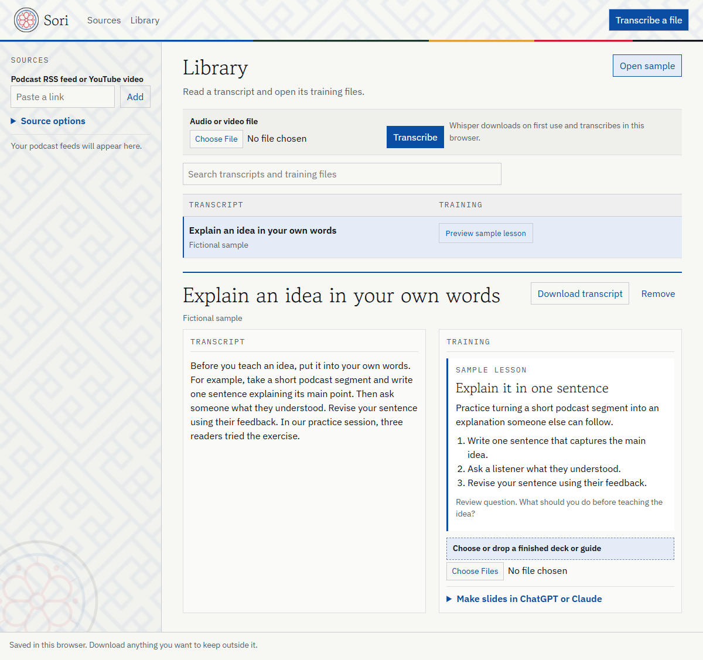
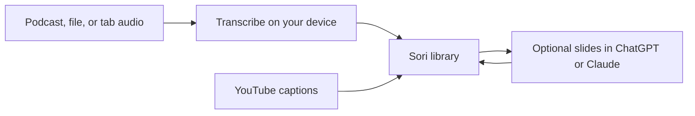

# Sori

Keep transcripts from YouTube, podcasts, and recordings beside your slides and
study guides. Sori transcribes audio on your device.

## Try Sori

1. Click **Download Sori setup ZIP** and save it in **Downloads**.
2. In **ChatGPT Desktop**, open **Codex** and choose **This computer**. Or
   open **Claude Desktop** and use **Claude Code** on your computer.
3. Paste the message below into the assistant.

   > Set up Sori from Sori-setup.zip in Downloads on this computer. Follow
   > SETUP.txt, then open Sori in my browser.

When Sori opens in your browser, click **Open sample**. The sample has a
fictional transcript and a short lesson you can try right away.

## Add your own material

- **YouTube.** Paste a video link in **Sources** and click **Add**. Open the
  video and choose **Show transcript** in its description. You can leave the
  video paused. Paste the text into Sori and click **Save transcript**. If
  captions are missing or inaccurate, choose **Record the video's audio**
  for guided steps in desktop Chrome, or **Find a podcast feed** to search by
  show name.
- **Podcasts and files.** Paste a podcast RSS link in **Sources** and choose an
  episode, or pick an audio or video file. Click **Transcribe**. Stay online
  the first time so Whisper can download.
  Some publishers block direct audio downloads. In that case, click **Open
  audio** and import a copy you can access.
- **Other websites.** In desktop Chrome, open **Source options** and choose
  **Record tab audio**. Share the tab with its audio on, play the part you
  want, then return to Sori and click **Finish and transcribe**.
- **Make slides.** Open a transcript and choose **Make slides in ChatGPT or
  Claude**. Paste the request into your chat, then bring the finished
  PowerPoint or study guide back to the same transcript in Sori.

Your library is stored in the browser you use to open Sori. Download copies of
transcripts or files you want to keep elsewhere. The chat service receives a
transcript when you choose to send it. [Privacy](PRIVACY.md)

This release was tested in Chrome on Windows. Safari transcription and
first-time setup through Claude Desktop still need a Mac trial.

[Release notes](https://github.com/onepromptman/sori-app/releases/tag/v3.4.3) ·
[Build or host Sori](docs/HOSTING.md) · [MIT license](LICENSE) ·
[Security reporting](SECURITY.md)
