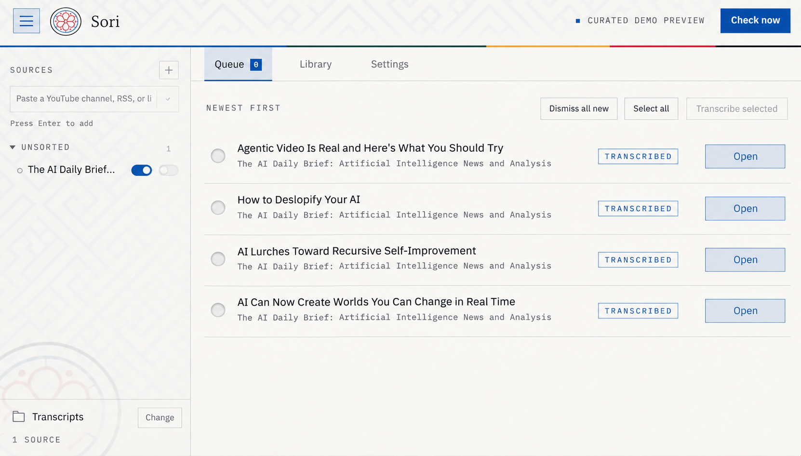

# Sori

Turn audio and podcasts into searchable transcripts and keep the finished
slides with them. The web edition runs Whisper in your browser. You can
transcribe without an account or chatbot.

## Try Sori

1. Save [Sori-setup.zip](https://github.com/onepromptman/sori-app/releases/download/v3.4.2/Sori-setup.zip)
   in Downloads. The same ZIP works with a local desktop assistant on Mac
   or Windows.
2. In ChatGPT Desktop, open **Codex** on **This computer**. In Claude
   Desktop, use **Claude Code** on your computer. Paste:

   > Set up Sori from Sori-setup.zip in Downloads on this computer. Follow
   > SETUP.txt, then open Sori in my browser.

3. Click **Open sample** to see a transcript and its training side by side.
   Choose an audio file or paste a podcast RSS URL, then click **Transcribe**.
   Stay online for the first speech model download.

To make slides, copy the request into ChatGPT or Claude. Download the
PowerPoint or study guide and add it to the same transcript in Sori.
Your transcripts and imported training stay in this browser.
See the [trial and hosting guide](docs/HOSTING.md).

YouTube links are saved so you can open the original. To transcribe an
episode, use its podcast feed or choose an audio file you can access. A feed
may list episodes even when its audio host blocks direct browser downloads.
Choose **Open audio** or import a file in that case. To try The AI Daily
Brief, paste `https://anchor.fm/s/f7cac464/podcast/rss` into **Sources**.

<details>
<summary>Earlier desktop releases and local launchers</summary>

The earlier [3.4.0 beta](https://github.com/onepromptman/sori-app/releases/tag/v3.4.0)
uses its own Python launcher. Open the release for its download and setup steps.
For the current desktop source and bundled launcher builds, see **For engineers**.

### Transcribe an episode

Click **Try a sample transcript** or paste a podcast RSS feed into **Sources**,
press Enter, and click **Transcribe**. Find the result in **Library**.

If YouTube limits captions, try the show's podcast feed.

### Make slides in the desktop edition

1. Open a transcript and click **Make slides**.
2. Choose **Open ChatGPT** or **Open Claude**. Sori copies the request and transcript.
3. Paste it into your chat and ask it to create an editable PowerPoint and study guide.
   Download the result from the chat if file creation is available.

Sori keeps your transcript local until you choose to share it. The chat service
you choose handles the pasted text under its own settings. [Privacy](PRIVACY.md)

Use **Settings > Stop** to close Sori. Open the launcher to start it again.

</details>




## For engineers

Build the standalone ZIPs from tracked source with Python 3.11+, Git, and uv:

```sh
python portable_release.py --output build/portable --cache build/runtime windows mac-arm mac-intel
```

The Mac bundles target macOS 14 or newer. The Mac ZIPs use executable
launchers and have not been through Apple notarization. Test on the target
hardware before distribution.

For source use on Mac, Windows, or Linux, run `python start_sori.py` with
Python 3.11 or newer. The browser file picker is available on Windows.
The server listens at `127.0.0.1:17654` for local use.

`python package.py` builds the Python-required browser, source, and plugin ZIPs.
The optional Claude plugin and advanced CLI are documented separately.
See [CLI](docs/CLI.md), [pipeline](docs/PIPELINE.md), [automation](docs/AUTOMATE.md),
[acceptance](ACCEPTANCE.md), and [third-party notices](THIRD-PARTY-NOTICES.md).

[MIT license](LICENSE). [Security reporting](SECURITY.md).
