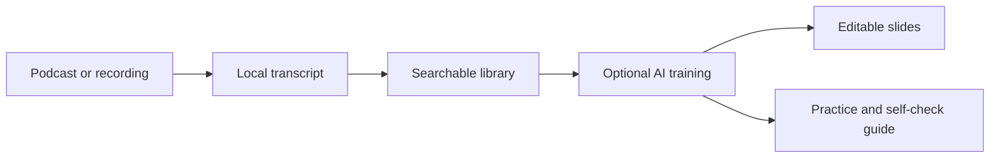

# Sori

**Turn a podcast into a lesson you can use.** Sori helps independent learners
transcribe podcasts, search their listening library, and create editable
training decks and self-study guides.

Built by [OnePromptMan](https://github.com/onepromptman). Open source under the
MIT license. Local transcription needs no Sori account or API key.

## Open Sori in your browser

Sori opens in your browser and runs on your computer. You do not need an
account, an AI subscription, or Ollama to read or transcribe episodes.

1. [Download Sori-browser.zip](https://github.com/onepromptman/sori-app/releases/download/v3.4.0/Sori-browser.zip).
2. Unzip it. On Mac, double-click the ZIP. On Windows, right-click it and choose **Extract All**.
3. Open the extracted **Sori** folder. On Mac, open **START SORI.command**.
   On Windows, open **START SORI.bat**. For Linux or a Mac that cannot open
   the launcher, see [Terminal launch](#terminal-launch).

Leave the separate launcher window open. The first start needs internet and can
take a few minutes. If Sori asks for Python, install
[Python 3.11 or newer](https://www.python.org/downloads/) and open the launcher again.
On Windows, include the Python launcher.

### Try your first transcript

Click **Try a sample transcript** to explore the Library right away. Sori prepares
its default English speech model in the background on a normal launch if needed
(about 150 MB). No separate model install is required.

For a real episode, paste a podcast RSS feed into **Sources**, press Enter, and
click **Transcribe**. Open **Library** when it's ready. For example, copy
`https://anchor.fm/s/f7cac464/podcast/rss` for The AI Daily Brief. If YouTube
limits caption requests, use the show's podcast RSS feed where available.

The [published 3.4.0 beta](https://github.com/onepromptman/sori-app/releases/tag/v3.4.0)
downloads the model when you first transcribe and labels its lesson button
**Generate Training**. The updated setup and lesson shortcuts described here
are in the 3.4.1 beta build from this source. Mac and Linux are still in beta.

### Let a desktop assistant open it

If you already use a desktop assistant that can run commands on your computer,
save **Sori-browser.zip** to Downloads, give the assistant access to that folder,
and say:

> Extract Sori-browser.zip from Downloads and start Sori on this computer.
> Use START SORI.command on Mac or START SORI.bat on Windows. Open Sori in my
> browser and tell me if Python is missing.

Use a local Codex or ChatGPT Work session, or a local Claude Code session.
The assistant may ask for permission to run the launcher. Uploading the ZIP to
a web chat alone cannot start Sori on your computer. The separate `sori.zip`
is an [optional Claude plugin](#claude-plugin-and-command-line).




*Edited queue preview with selected AI podcast headlines.*

## Try the samples

The download includes four original fictional transcripts in **SAMPLES**.
Open a TXT file to read it immediately. To explore them in Library, follow the
included [sample instructions](examples/sample-transcripts/README.md).
They contain no real podcast, speaker, personal recording or customer material.
They demonstrate learning activities, not measured transcription accuracy.

## From listening to learning

Open a transcript and choose **Create a lesson**. You can copy the lesson prompt
and transcript into ChatGPT or Claude using **Copy lesson prompt**, with no Sori
API setup. Paste only transcripts you are comfortable sharing with that service.

To generate editable slides and a study guide directly in Sori, add your
[Claude API key](https://platform.claude.com/docs/en/get-api-key) from the same
screen. Save the key, choose **Create a lesson** again, and confirm. Sori provides
learning objectives, key concepts, a practice exercise, review questions, and a
separate answer key.

This beta's paid training route has automated mocked tests but has not received
a live paid acceptance test. Current account and model access remain unverified.

Training generation sends the transcript and episode metadata to Anthropic
and uses paid API credits. The app asks before a manual request or before
you enable **Auto-train** for a show. Auto-train authorizes future training
requests for that show, so turn it off when you no longer want them.


The training preview uses a fictional lesson. The sample outline was written for
testing and rendered by Sori, without a live AI call. Its [transcript](examples/learning-demo.txt)
and [outline](examples/learning-demo.json) are included so you can reproduce it.

The learning format is requested from the model; quality varies. Validation
checks slide structure, quote wording, and whether selected numeric values
occur in the transcript. It does not prove that a claim, attribution, unit,
or interpretation is correct. Check the transcript and answers before
relying on or sharing the training. Only use and redistribute material you
have permission to use.

## Let the library grow

- **Auto** checks a source for new episodes and queues transcription.
- **Auto-train** adds optional paid training after transcription.
- **Library** searches transcript text and exports text, Markdown and subtitles.
- **Settings** controls the model, language, output folder, key and deck theme.

Closing the tab leaves Sori running and checking sources hourly. **Settings >
Stop** shuts it down. Opening Sori again returns to the running copy. The app
does not automatically start after a reboot. The bundled daily-sweep setup
is an optional Windows scheduled task; see [automation](docs/AUTOMATE.md).

YouTube captions work when the source offers accessible captions in your
chosen language; some videos need additional tools or are unavailable.

## Your data and costs

Transcription runs locally without an API fee. Feed and model downloads use
the internet. Training through the app is a separate paid Anthropic call.
Using Sori in an AI chat client follows that client's subscription, usage
limits and data policies; it is not a promise of free AI access.

Your library and API key stay in your local Sori folder. The key is stored
unencrypted under your operating system account. Sori has no analytics or
cloud sync service, but your own backup software may copy the folder.
Read [privacy and data flow](PRIVACY.md) before adding private recordings.

## For engineers

### Run from source

The cross-platform launcher prepares the browser dependencies in Sori's
own environment and starts the local server:

```bash
python start_sori.py
```

#### Terminal launch

From the extracted **Sori** folder on macOS or Linux, run `sh "START SORI.command"`.
In a source checkout, use `python3 start_sori.py` instead. The app's local file
picker buttons currently require Windows; podcast RSS works without a picker.

For a manually managed environment on Windows:

```powershell
uv venv --python 3.11
uv pip install --python .venv/Scripts/python.exe -r requirements-browser.txt
.venv/Scripts/python.exe app.py
```

On macOS/Linux the environment interpreter is `.venv/bin/python`.
`requirements-app.txt` is the larger optional Windows packaging/desktop set.
The 3.4.0 browser release does not include a new Windows EXE.

The server binds only `127.0.0.1:17654`. It checks the Host header, request
origin and a per-launch token. Do not expose it through a public reverse proxy.
Set `SORI_PORT` for a different port or `SORI_HOME` for an isolated data folder.
`--window` opens the older desktop window; `--sweep` runs one scheduled pass.

### Optional training pipeline

The additional CLI/plugin workflow records stages, checks evidence in a learning
brief, and creates an offline deck or local handoff for another slide tool.
It does not run an unattended browser agent. See [pipeline](docs/PIPELINE.md)
and [optional launcher](docs/CLAUDE-NATIVE.md). External handoffs are manual and
client usage costs still apply.

### Claude plugin and command line

The prepared `sori.zip` contains the plugin at its root. Cowork upload remains
unverified. Claude Code can install the public repository's released version:

```
/plugin marketplace add onepromptman/sori-app
/plugin install sori@sori
```

Use `/sori:transcribe`, `/sori:shows`, `/sori:sweep` and `/sori:train`. Skills
run `preflight.py` to prepare their environment. A chat session can write an
outline and call `train.py --outline` without a separate Anthropic API call.
See [CLI documentation](docs/CLI.md) and [acceptance limits](ACCEPTANCE.md).

### Build public downloads

```powershell
.venv/Scripts/python.exe package.py
```

The default build needs only Python and Git. It stages tracked files into a
new folder under `build/` and creates **Sori-browser.zip**, **Sori-source.zip**,
**sori.zip**, source and browser-layout hash manifests, and **SHA256SUMS.txt** in its `release/`
folder. The browser ZIP is the primary download. To also build the optional
Windows executable, install `requirements-app.txt` and run
`python package.py --windows-exe`. That build excludes the private renderer. Stage intended new files in Git first. Untracked files are not copied.
Reusing an existing binary with `--no-build` is refused. Review source and
binary contents before manually publishing a new release.

Run `.venv/Scripts/python.exe -m pytest -q` for automated checks and
`.venv/Scripts/python.exe app.py --selftest` for installed backends. Tests
use disposable data and block paid API calls. Live transcription, paid
generation and signed-binary distribution require separate validation.

### Customize and troubleshoot

The public `studio` theme uses system fonts and needs no private component.
See [themes](themes/README.md), [upgrading](docs/UPGRADING.md), and
[maintaining](docs/MAINTAINING.md). Missing fonts may substitute on another PC.

Generated files live under `%USERPROFILE%/Sori` by default. Logs may contain
source host names, file names and error messages; review them before sharing.
Do not upload that data folder as part of a source or binary release.

## License

[MIT](LICENSE). Bundled fonts and dependencies retain their own licenses;
see [third-party notices](THIRD-PARTY-NOTICES.md). Security concerns belong in
the channel described in [SECURITY.md](SECURITY.md).
