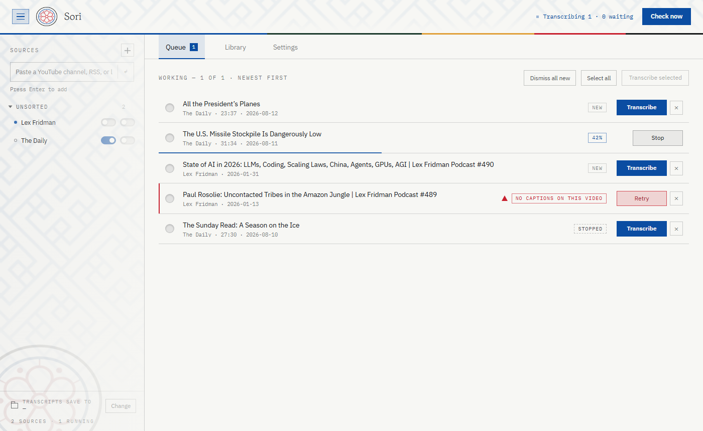
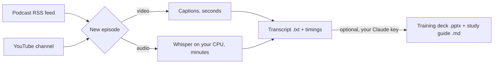

# Sori

Follow podcasts and YouTube channels, turn every new episode into text on
your own machine, and, if you want, turn a transcript into a training deck
and study guide.

Transcription is free and local on macOS, Linux and Windows: no account,
no API key, nothing leaves your computer except the feed and audio fetches. Training generation from
the app is the one paid step: it calls the Claude API with your own key, and
you can ignore it entirely. From Claude Code or Cowork the session writes
the deck outline itself and Sori only renders it, so that door needs no key.





## Get it

Sori is one engine behind two front doors. The **Claude-native Sori** (a
plugin plus the Python scripts, no window) runs on macOS, Linux and
Windows and is the route for everyone who is not on Windows or already
uses Claude; the **Windows app** stays first-class for people who never
open Claude. Both read and write the same `~/Sori` folder, and one parity
rule holds: anything the window can do, the CLI can do too.

| Route | For | Steps |
|---|---|---|
| **Claude plugin** (Claude Desktop Code tab, Claude Code, or Cowork) | Mac, Linux, and anyone who uses Claude. No installer, no `.dmg`, nothing to sign | In Claude: **Customize > Plugins > Add marketplace** `onepromptman/sori-app`, add **sori**. Or in Claude Code: `/plugin marketplace add onepromptman/sori-app` then `/plugin install sori@sori`. Then `/sori:setup` once, and `/sori:transcribe`, `/sori:shows`, `/sori:sweep`, `/sori:train`. Full guide: [docs/CLAUDE-NATIVE.md](docs/CLAUDE-NATIVE.md) |
| **Windows app** | Windows users who never open Claude | download `Sori-win64.zip` from the [latest release](https://github.com/onepromptman/sori-app/releases/latest), extract, double-click `Sori.exe` |
| **Command line** | any OS, one transcript now, or scripting | `git clone`, then `python3 sori.py transcribe youtube "<url>" --out ep.txt`. `sori.py` creates Sori's own Python environment in `~/Sori/.venv` on first use; `shows`, `settings`, `sweep`, `train` are the other verbs, see [docs/CLI.md](docs/CLI.md) |
| **From source, the window** | developers | `python3 sori.py --profile app setup` then `python3 sori.py app` |

**CLI-only for now:** nothing. Every window feature has a CLI twin:
`shows` mirrors the source list (add, remove, Auto, Auto-train, folders)
and `settings` mirrors Settings, so the app shows whatever the CLI did and
vice versa. Scheduling options (Windows task, Cowork, launchd/cron, cloud
routine) are compared in [docs/AUTOMATE.md](docs/AUTOMATE.md). Why the
plugin, and not a Mac app, a cloud service or a ChatGPT app, is written up
in [docs/HOSTING.md](docs/HOSTING.md); what Sori does and does not touch is
in [docs/SECURITY.md](docs/SECURITY.md).

**On a Mac** transcription runs on the GPU: `sori.py` installs
`mlx-whisper` on Apple Silicon and picks it automatically, so `large-v3` is
affordable on a laptop. Everything else is identical.

Two things on the first app launch. Extract the zip before running
(right-click, **Extract All**); an exe run from inside the zip window fails
with *Failed to load Python DLL* because Windows extracts it alone. And
the blue *Windows protected your PC* box is SmartScreen, which shows for
any app without paid code-signing; click **More info, Run anyway** once.

## Use it

- **Add a source.** Paste a podcast RSS feed, a YouTube channel or
  `@handle`, or a playlist into the box on the left. The **+** menu also
  adds your own audio files and folders for grouping.
- **Queue** shows what is new. **Transcribe** one, tick several, or
  **Stop** a running job. Anything you pick by hand runs next, ahead of
  what Auto queued (Stop the running one first if you want yours now).
- **Dismiss** (the × on a row, or **Dismiss all new**) skips an episode
  for good. It will not come back on the next check or after a restart.
- **Auto** on a source transcribes its new episodes by itself while the
  app is open. **Auto-train** also generates a training after each one
  (needs a key).
- **Library** holds every transcript with search *inside* the text. The
  reader has timestamps, find, copy, `.md` and `.srt` export, and
  **Generate Training**.
- **Settings**: Whisper model, caption language, transcript folder, deck
  theme, Claude API key.

Two things that keep the queue sane. Follow a show through one door, not
both; the same show as RSS *and* YouTube gives you every episode twice, and
Sori warns when you add the second. And on a laptop CPU, `small.en` is
about five times faster than `large-v3` with nearly the same quality on
talk shows; three daily shows on Auto with `large-v3` will not drain.

The first audio transcription downloads the Whisper model, about 150 MB,
once per machine.

## Training generation

**Generate Training** on any transcript, or Auto-train on a show, sends the
transcript to Claude and gets back a deck outline plus a study guide,
grounded in the transcript only: the model is told not to invent numbers,
dates, or quotes it cannot point to. The deck renders as a real, editable
`.pptx` — fourteen slide kinds, including stat, chart and scorecard layouts
that only appear when the episode actually stated the figures.


Decks ship in the **`studio`** theme: an unbranded editorial look in fonts
every machine already has, so nothing is installed and a deck you send to a
colleague opens looking the way you left it. Themes are a swappable file —
change six colours, or drop in your own renderer. See
[themes/README.md](themes/README.md).

Add your key under **Settings, Training generation** (or `settings.py api-key
set`). It is stored only in your user folder, never logged, never synced. One
API call per deck; you pay Anthropic directly at their rates. `/sori:train`
skips the call: the session writes the outline against the same rules and
`train.py --outline` renders it with the same engine (see docs/CLI.md).

Everything Sori makes lives in `~/Sori/` (`%USERPROFILE%\Sori\` on Windows)
and survives replacing the app: `Transcripts/<Show>/`, `Trainings/<Show>/`,
`shows.json`, `credentials.json`, `sweep.log`, and on the Claude door its own
Python environment in `.venv/`.

## From a transcript to a training, on a schedule

Monitoring is `shows add <url> --auto` plus the daily sweep. From 3.4 the
plugin also carries the rest of the way: `/sori:curate` triages each new
transcript against your `~/Sori/curriculum.md` (a curator agent), writes
the L&D brief for the ones worth teaching (an instructional-design agent),
has it reviewed by a critic that is never the author, and records every
stage in `~/Sori/ledger.jsonl`. `/sori:design` then turns a passed brief
into a deck through the backend you pick once: the offline `.pptx`
renderer (default, needs nothing), a Claude Design Slides artifact with your
design system attached, the d_sign HTML masters, or a hand-off for ChatSlide
or Figma Slides. No API key anywhere in that chain. How it fits together:
[docs/PIPELINE.md](docs/PIPELINE.md); which design system is which:
[docs/DESIGN-SYSTEMS.md](docs/DESIGN-SYSTEMS.md).

## Every morning, automatically

The simplest route on Windows: double-click **`setup-auto-sweep.bat`** in
the unzipped folder. It registers a Windows task at 9:03 daily that checks
every show, transcribes new episodes for Auto shows, and trains the
Auto-train ones. Nothing appears on screen; each run appends to `sweep.log`.
Remove it with:

```
schtasks /delete /tn "Sori Daily Sweep" /f
```

On a Mac or Linux box: a Cowork schedule, or launchd/cron calling
`python3 sori.py sweep`. All four ways, with their trade-offs, are in
[docs/AUTOMATE.md](docs/AUTOMATE.md).

Upgrading from an Earshot or Podcast Studio build? See
[docs/UPGRADING.md](docs/UPGRADING.md).

## Make it yours

Settings covers what most people change: model, language, where transcripts
go, deck theme, key, and the per-show Auto switches. The rest is one
constant each; edit, then rebuild.

| Change | Where |
|---|---|
| Voice and shape of every training | `SYSTEM_PROMPT` in `training.py`, five house rules; rewrite them and the output changes completely |
| Which Claude model writes it | `DEFAULT_MODEL` in `training.py` |
| Deck length and slide types | `SLIDE_KINDS` and the `slides` min/max in `training.py` |
| Cost ceiling per episode | `MAX_TRANSCRIPT_CHARS` in `training.py` |
| Deck look | six colours and three font names at the top of `themes/studio.py`, or a whole new backend — see [themes/README.md](themes/README.md) |
| Daily sweep time | the `/st 09:03` in `setup-auto-sweep.bat` |

Only training generation has a look to change. For transcripts alone,
`training.py` and `themes/` are never touched.

## Build the exe

```bash
pip install -r requirements-app.txt
python package.py            # PyInstaller + the files that must sit beside the exe + zip
python package.py --no-build # re-zip an existing dist/Sori
```

`package.py` exists because PyInstaller emits only `Sori.exe` and
`_internal/`; the sidecar files a downloader needs (`setup-auto-sweep.bat`,
licences, the quick-start text) are copied in afterwards, and it fails
loudly if one is missing.

## License

MIT, see [LICENSE](LICENSE). Bundled fonts (Gowun Batang, IBM Plex) are
SIL OFL 1.1 and Python dependencies keep their own licences; see
[THIRD-PARTY-NOTICES.md](THIRD-PARTY-NOTICES.md), which also ships in the
zip.
