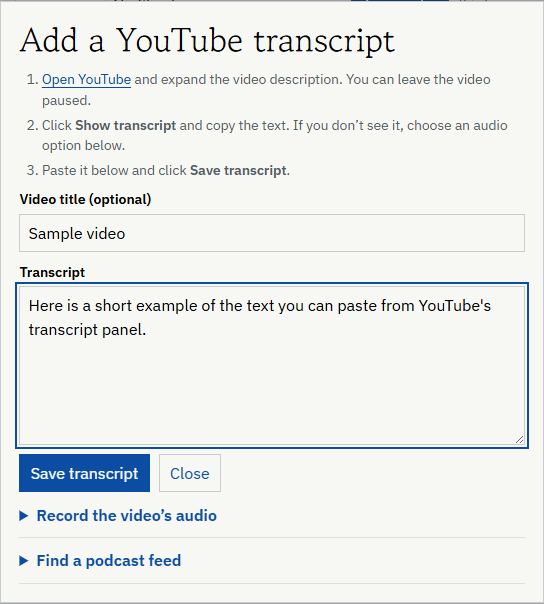
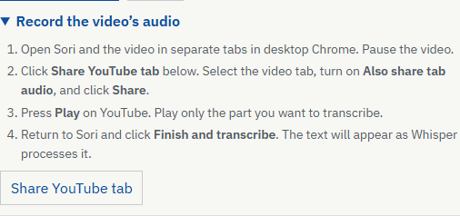
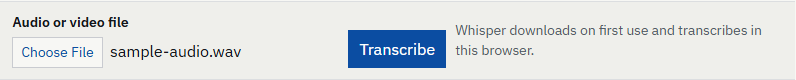
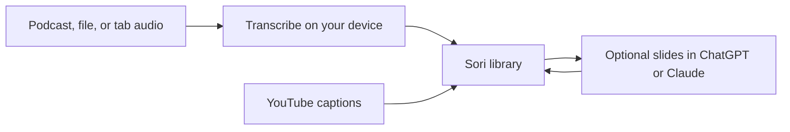

# Sori

Keep transcripts from YouTube, podcasts, and recordings beside your slides and
study guides. Sori transcribes audio on your device.

## Try Sori

1. Click **Download Sori setup ZIP** and save it in **Downloads**.
2. In **ChatGPT Desktop**, open **Codex** and choose **This computer**. Or
   open **Claude Desktop** and use **Claude Code** on your computer.
3. Paste the message below into the assistant.

   > Set up Sori from Sori-setup.zip in Downloads on this computer. Follow
   > SETUP.txt, then open Sori in my browser.

When Sori opens in your browser, click **Open sample**. The sample has a
fictional transcript and a short lesson you can try right away.

## Add your own material

### Copy YouTube captions

Paste a video link in **Sources** and click **Add**. Open the video, expand
its description, and choose **Show transcript**. You can leave the video
paused. Copy the text, paste it into Sori, and click **Save transcript**.

### Record audio from YouTube or another tab

Open Sori and the video in separate tabs in **desktop Chrome**. If captions
are missing or inaccurate, expand **Record the video's audio** in Sori.
Select **Share YouTube tab**, choose the video tab, and turn on **Also share
tab audio**. Play only the part you want, return to Sori, and click **Finish
and transcribe**. You'll see a text preview as Whisper works.

For another website, use **Source options > Record tab audio**.

### Transcribe a podcast episode

Paste a podcast RSS link in **Sources**, or open **Find a podcast feed**
from the YouTube dialog and search by show name. Add the matching feed,
pick an episode, and click **Transcribe**. If the publisher blocks the
audio request, use **Open audio** to get a copy you can import.

### Transcribe a file

Choose an audio or video file and click **Transcribe**. Stay online the
first time you transcribe audio so Whisper can download.

## Make slides

Open a transcript and choose **Make slides in ChatGPT or Claude**. Paste
the request into your chat, then bring the finished PowerPoint or study
guide back to the same transcript in Sori.

Your library is stored in the browser you use to open Sori. Download copies of
transcripts or files you want to keep elsewhere. The chat service receives a
transcript when you choose to send it. [Privacy](PRIVACY.md)

This release was tested in Chrome on Windows. Safari transcription and
first-time setup through Claude Desktop still need a Mac trial.

[Release notes](https://github.com/onepromptman/sori-app/releases/tag/v3.4.3) ·
[Build or host Sori](docs/HOSTING.md) · [MIT license](LICENSE) ·
[Security reporting](SECURITY.md)
