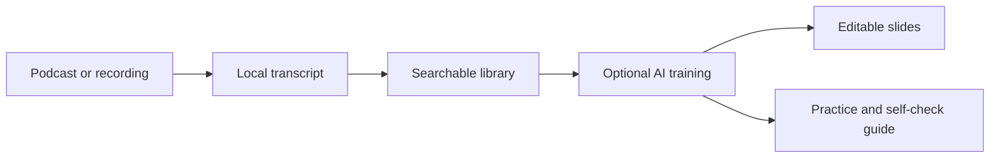
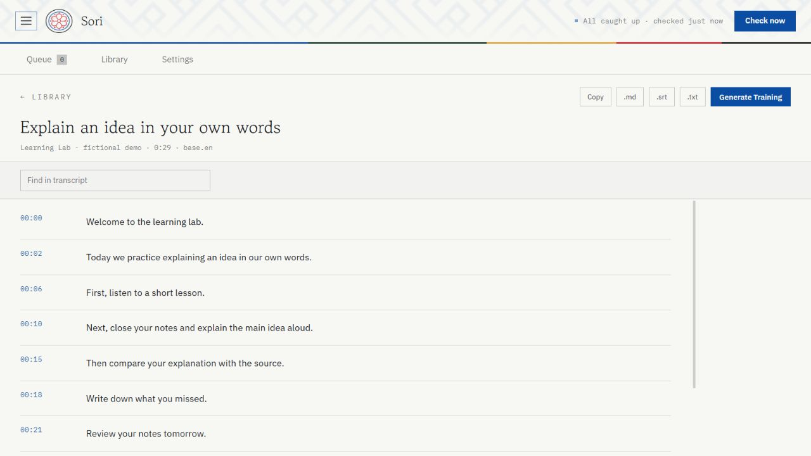

# Sori

**Turn a podcast into a lesson you can use.** Sori helps independent learners
transcribe podcasts, search their listening library, and create editable
training decks and self-study guides.

Built by [OnePromptMan](https://github.com/onepromptman). Open source under the
MIT license. Local transcription needs no Sori account or API key.





## Start here

This is a **downloadable local browser app for Windows**. It opens in your
normal browser and processes audio on your PC. It is not a hosted website:
you install it once, and your computer must stay on while it works.

**Browser edition: release candidate 3.2.2, prepared locally.** The
[public release page](https://github.com/onepromptman/sori-app/releases/latest)
currently offers the earlier desktop edition. Publish the reviewed 3.2.2
artifacts before advertising the browser edition as available there.

For the browser edition ZIP:

1. Download **Sori-win64.zip**, right-click it, and choose **Extract All**.
2. Open the extracted folder and double-click **Sori.exe**. Sori opens a tab
   in your default browser. The unsigned app may trigger a Windows warning;
   verify the source and release checksum before choosing to run it.
3. Paste a podcast RSS feed into the source box. Pick an episode and click
   **Transcribe**. Read and search the result in **Library**.

You need Windows 10 or 11, disk space for the app and speech model, and an
internet connection to fetch episodes and download the model the first time.
You can also add your own audio from the **+** menu. YouTube captions work
when the source offers accessible captions in your chosen language; some
videos need additional download tools or are unavailable.

## From listening to learning

Open a transcript in Library and choose **Generate Training**. With your own
Claude API key saved in Settings, Sori requests an editable slide deck and a
study guide with learning objectives, key concepts, a practice exercise,
retrieval questions, a separate answer key, and suggested review sessions.

Training generation sends the transcript and episode metadata to Anthropic
and uses paid API credits. The app asks before a manual request or before
you enable **Auto-train** for a show. Auto-train authorizes future training
requests for that show, so turn it off when you no longer want them.


The screenshots use a fictional lesson. The sample outline was written for
testing and rendered by Sori, without a live AI call. Its [transcript](examples/learning-demo.txt)
and [outline](examples/learning-demo.json) are included so you can reproduce it.

The learning format is requested from the model; quality varies. Validation
checks slide structure, quote wording, and whether selected numeric values
occur in the transcript. It does not prove that a claim, attribution, unit,
or interpretation is correct. Check the transcript and answers before
relying on or sharing the training. Only use and redistribute material you
have permission to use.

## Let the library grow

- **Auto** checks a source for new episodes and queues transcription.
- **Auto-train** adds optional paid training after transcription.
- **Library** searches transcript text and exports text, Markdown and subtitles.
- **Settings** controls the model, language, output folder, key and deck theme.

Closing the tab leaves Sori running and checking sources hourly. **Settings >
Stop** shuts it down. Opening Sori again returns to the running copy. The app
does not automatically start after a reboot. The bundled daily-sweep setup
is an optional Windows scheduled task; see [automation](docs/AUTOMATE.md).

## Your data and costs

Transcription runs locally without an API fee. Feed and model downloads use
the internet. Training through the app is a separate paid Anthropic call.
Using Sori in an AI chat client follows that client's subscription, usage
limits and data policies; it is not a promise of free AI access.

Your library and API key stay in your local Sori folder. The key is stored
unencrypted under your operating system account. Sori has no analytics or
cloud sync service, but your own backup software may copy the folder.
Read [privacy and data flow](PRIVACY.md) before adding private recordings.

## For engineers

### Run from source

Use Python 3.11 or newer and an isolated environment. From the extracted
source directory on Windows:

```powershell
uv venv --python 3.11
uv pip install --python .venv/Scripts/python.exe -r requirements-app.txt
.venv/Scripts/python.exe app.py
```

On macOS/Linux use `.venv/bin/python`. Browser file pickers are Windows-only;
the CLI is the supported alternative for adding local files there. These
platforms have not received the packaged Windows acceptance checks.

The server binds only `127.0.0.1:17654`. It checks the Host header, request
origin and a per-launch token. Do not expose it through a public reverse proxy.
Set `SORI_PORT` for a different port or `SORI_HOME` for an isolated data folder.
`--window` opens the older desktop window; `--sweep` runs one scheduled pass.

### Claude plugin and command line

The prepared `sori.zip` contains the plugin at its root. Cowork upload remains
unverified. Claude Code can install the public repository's released version:

```
/plugin marketplace add onepromptman/sori-app
/plugin install sori@sori
```

Use `/sori:transcribe`, `/sori:shows`, `/sori:sweep` and `/sori:train`. Skills
run `preflight.py` to prepare their environment. A chat session can write an
outline and call `train.py --outline` without a separate Anthropic API call.
See [CLI documentation](docs/CLI.md) and [acceptance limits](ACCEPTANCE.md).

### Build public downloads

```powershell
.venv/Scripts/python.exe package.py
```

The builder stages tracked files into a new folder under `build/`, excludes
the optional private renderer, and creates **Sori-win64.zip**, **Sori-source.zip**,
**sori.zip**, a source hash manifest, and **SHA256SUMS.txt** in its `release/`
folder. Stage intended new files in Git first. Untracked files are not copied.
Reusing an existing binary with `--no-build` is refused. Review source and
binary contents before manually publishing a new release.

Run `.venv/Scripts/python.exe -m pytest -q` for automated checks and
`.venv/Scripts/python.exe app.py --selftest` for installed backends. Tests
use disposable data and block paid API calls. Live transcription, paid
generation and signed-binary distribution require separate validation.

### Customize and troubleshoot

The public `studio` theme uses system fonts and needs no private component.
See [themes](themes/README.md), [upgrading](docs/UPGRADING.md), and
[maintaining](docs/MAINTAINING.md). Missing fonts may substitute on another PC.

Generated files live under `%USERPROFILE%/Sori` by default. Logs may contain
source host names, file names and error messages; review them before sharing.
Do not upload that data folder as part of a source or binary release.

## License

[MIT](LICENSE). Bundled fonts and dependencies retain their own licenses;
see [third-party notices](THIRD-PARTY-NOTICES.md). Security concerns belong in
the channel described in [SECURITY.md](SECURITY.md).
