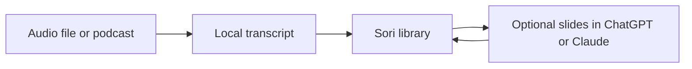

# Sori

Turn podcasts and recordings into searchable transcripts and keep your slides
and study guides beside them. Sori runs Whisper in your browser.

## Try Sori

1. Click **Download Sori setup ZIP** and save it in **Downloads**.
2. In **ChatGPT Desktop**, open **Codex** and choose **This computer**. Or
   open **Claude Desktop** and use **Claude Code** on your computer.
3. Paste the message below into the assistant.

   > Set up Sori from Sori-setup.zip in Downloads on this computer. Follow
   > SETUP.txt, then open Sori in my browser.

When Sori opens in your browser, click **Open sample**. The sample has a
fictional transcript and a short lesson you can try right away.

## Transcribe and make slides

- **Transcribe.** Pick an audio file or paste a podcast RSS URL in **Sources**.
  Click **Transcribe**. Stay online the first time so Whisper can download.
  Some publishers block direct audio downloads. In that case, click **Open
  audio** and import a copy you can access.
- **Use YouTube links.** Save a video, playlist, or channel to open it later.
  For transcription, use the show's podcast feed or a media file you can
  access. The AI Daily Brief feed is
  `https://anchor.fm/s/f7cac464/podcast/rss`.
- **Make slides.** Open a transcript and choose **Make slides in ChatGPT or
  Claude**. Paste the request into your chat, then bring the finished
  PowerPoint or study guide back to the same transcript in Sori.

Your library is stored in the browser you use to open Sori. Download copies of
transcripts or files you want to keep elsewhere. The chat service receives a
transcript when you choose to send it. [Privacy](PRIVACY.md)

The web beta was tested in Chrome on Windows. Full transcription in Mac Safari
and first-time setup through Claude Desktop still need a Mac trial.

[Release notes](https://github.com/onepromptman/sori-app/releases/tag/v3.4.2) ·
[Build or host Sori](docs/HOSTING.md) · [MIT license](LICENSE) ·
[Security reporting](SECURITY.md)
