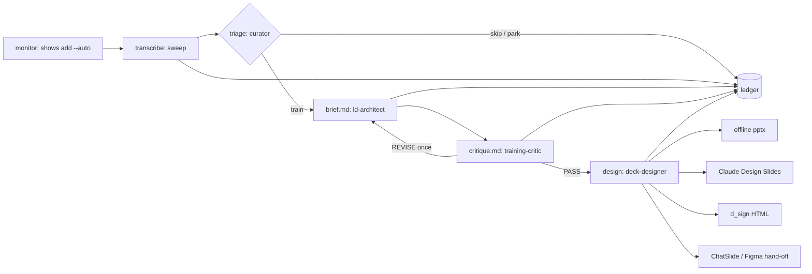

# The training pipeline: monitor → transcribe → triage → brief → critique → design

Sori's engine stops at a transcript. From 3.4 the plugin carries the rest
of the way to a deck, as a pipeline of stages with one artifact each, a
ledger that records every stage, and four agents that do the thinking. No
API key is involved: the agents run in your Claude session.



## Why the brief is the center, not the slide outline

Until 3.3 the only contract was `outline.json`: a list of slides in twelve
kinds that `train.py` validated and a Python renderer painted. That shape
exists because the API route needed something a validator could check.
Once an agent is the author, forcing it to think in slide JSON is parsing
nobody needs, and it ties the deck to one renderer.

So the contract moved up a level. `brief.md` carries what the training
*is* (objectives, audience, the DO step, verbatim evidence, what to leave
out) plus a slide *recommendation*. Any slide tool can consume it. The
sourcing rules moved with it: `pipeline/brief.py` checks that every
Evidence quote is in the transcript word for word, and the critic reads
each quote in context. The outline schema stays as one render target (the
offline backend, and the exe), no longer as the thing agents must write.

## Stages, artifacts, owners

Every episode gets one folder, `~/Sori/Trainings/<Show>/<date> - <title>/`.

| Stage | Who | Reads | Writes | Ledger row |
|---|---|---|---|---|
| discovered | the sweep | feeds | | `discovered` |
| transcribed | the sweep / `transcribe` | audio or captions | `Transcripts/<Show>/<name>.txt` + `.json` timings | `transcribed` |
| triaged | **curator** (haiku) | transcript, `~/Sori/curriculum.md` | `triage.json`: train / park / skip, themes, objectives, quotable moments | `triaged`, and `skipped` for skip |
| briefed | **ld-architect** (opus) | transcript, triage, curriculum | `brief.md` (passes `sori.py brief-check`) | `briefed` |
| critiqued | **training-critic** (sonnet, never the author) | brief, transcript | `critique.md`: PASS / REVISE | `critiqued` |
| designed / rendered | **deck-designer** (opus) | brief, evidence, the backend's README | `handoff/<backend>/`, then the deck | `designed` or `rendered` |
| reviewed | you | the deck | | `reviewed` |

Maker ≠ checker is structural: the critic is a different agent on a
different model, it is read-only, and a second REVISE goes to you, not to
a third draft. This is the same pair that authors `ai-group-training`
(`ld-architect` / `training-critic`), scoped to one episode.

## The brief contract

```
# Brief: <title>
show: S    date: YYYY-MM-DD    source: <url>
## Objectives            2 to 6 observable "After this session a <role> can ..." bullets
## Audience
## DO step               a 10-minute exercise and the artifact it produces
## Evidence              3+ bullets: - [mm:ss] "verbatim quote" — why it earns a slide
## Leave out
## Slide recommendation  6 to 24 lines: n. [kind] text; opens [cover], carries [exercise], ends [closing]
```

`python3 sori.py brief-template "<title>"` prints the skeleton;
`python3 sori.py brief-check brief.md transcript.txt` is the gate (exit 1
with the findings). Normalisation before the quote match is whitespace and
curly quotes only; a paraphrase fails, by design.

## Design backends

| backend | renders | needs | who does the last step |
|---|---|---|---|
| `offline` (default) | `train.py --outline` → `.pptx` + study guide, `studio` theme | nothing | the agent writes `outline.json` from the brief, `sori.py design` renders |
| `claude-design` | a Slides artifact with your design system attached | a Claude session; a design system picked once | the deck-designer agent, in session; the artifact stays private to you |
| `dsign-html` | the d_sign masters (nok / baek / jeok) → HTML slides, PDF/PNG, `@dsCard` files | a `d_sign` checkout + node | the agent, as `decks/m00.../BUILD-NOTES.md` does |
| `chatslide` | chatslide.ai from an uploaded document | a ChatSlide account; no public API | you upload `handoff/chatslide/source-document.md` |
| `figma` | Figma Slides via the `figma-use-slides` skill | the Figma connector | the agent |

```bash
python3 sori.py design-config design_backend claude-design
python3 sori.py design-config design_system_url https://claude.ai/artifact/<your design system>
python3 sori.py design "<episode folder>" [--backend ...]
```

`sori.py design` writes `handoff/<backend>/` (brief, verbatim evidence,
a README of exact steps, backend extras such as `slide-map.json` for
d_sign or `source-document.md` for ChatSlide). It refuses a brief that
fails the gate, whatever the critique says. Settings live in
`~/Sori/pipeline.json`; the window has no pane for them yet (CLI-only, by
the parity rule that means a noted gap, not a hidden one).

"With and without" is one codebase and one setting. The public plugin
defaults to `offline` and needs nothing. Your own install sets
`claude-design` (or `dsign-html`) once and every `/sori:design` goes there.
A `chatslide` install is the same switch. No forks, no copies to keep in
sync.

## Running it

- **By hand:** `/sori:curate` after a sweep, then `/sori:design` for the
  briefs that passed.
- **Scheduled:** the Cowork prompt in [AUTOMATE.md](AUTOMATE.md) (b) runs
  `/sori:sweep` then `/sori:curate` daily on this computer and reports.
  Decks are built on request or, if you set a backend and say so in the
  prompt, in the same run. For the owner's own viewing, an unattended
  Claude Design build is fine; the artifact is private until shared.
- **Status:** `python3 sori.py ledger [--days 7]`.

## Ledger

`~/Sori/ledger.jsonl`, append-only, one row per stage change:

```json
{"at":"2026-10-27T09:04:11Z","show":"Lex Fridman","episode_id":"yt:abc","title":"#502 ...",
 "stage":"briefed","by":"ld-architect","artifact":"Trainings/Lex Fridman/2026-10-26 - #502/brief.md","note":""}
```

The engine writes `discovered` and `transcribed` (fail-open: a ledger
problem never fails a transcription), `train.py` writes `rendered`, and
the agents write the rest through `sori.py ledger add`. `latest()` keeps
the furthest stage per episode, so `skipped` after `transcribed` is the
state and a later `briefed` moves it on. The ledger holds paths and
titles, never transcript text or a key.

## What is not built yet

- A Sori-side HTML renderer for the d_sign masters (`dsign-html` is a
  hand-off the agent executes by hand, as the exemplar deck was built).
  Worth building once the masters' slot structure is stable; see
  [DESIGN-SYSTEMS.md](DESIGN-SYSTEMS.md).
- A window pane for `pipeline.json` and the ledger.
- Deck export back into the episode folder from Claude Design is the
  agent's manual step today.
