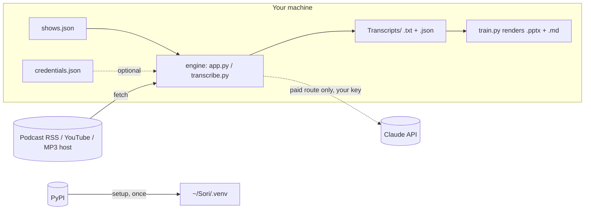

# Security model

What Sori touches, what it never touches, and what each door adds. Short
version: Sori is local-first; the only network calls are the feeds and
audio you asked for, plus PyPI once during setup; the only secret is an
optional Claude API key that stays in one file in your home folder.

## Data flow

Nothing is sent anywhere else. There is no telemetry, no account, no
update check, no crash reporter.

## What leaves the machine

| Call | When | What is sent |
|---|---|---|
| Feed fetch (RSS XML, YouTube channel Atom) | `shows check`, the sweep, the window's hourly poll | A GET with a `podcast-transcriber/1.0` user agent. Nothing about you. |
| Caption or audio fetch | Transcribing | yt-dlp's requests to YouTube, or a GET of the episode MP3. |
| Package install | `sori.py setup` / `update` | pip or uv talking to PyPI. |
| Whisper model download | First transcription per model | Hugging Face Hub, read-only, no account. |
| Claude API call | **Only** the paid route: the exe's Generate Training, Auto-train, or `train.py` without `--outline` | The transcript text (capped at `MAX_TRANSCRIPT_CHARS`) and episode metadata, with your key. Billed to you. |

The Claude-native default (`/sori:train`) makes no API call from Sori:
the session you are already in writes the outline and `train.py` renders
it. The transcript is read by that session like any file you open with
Claude, under your Claude plan's terms, not through a key Sori holds.

## The one secret

The Claude API key, if you add one, lives in `~/Sori/credentials.json`
(`%USERPROFILE%\Sori\credentials.json` on Windows), separate from
`shows.json` so a settings dump or a shared `shows.json` can never carry
it.

Rules the code enforces:

- No CLI accepts a key as an argument. `settings api-key set` reads
  `ANTHROPIC_API_KEY` from the environment of that one process; `train.py`
  refuses a stray `--api-key` with exit 2 and spends nothing.
- Nothing prints a key beyond its last four characters (`settings show`,
  `api-key status`). `sori.py doctor` reports only whether the file exists.
- The desktop app and its scheduled sweep read the saved key only. The
  environment variable is honoured by the engine **only** when
  `SORI_KEY_FROM_ENV=1` is also set, which exactly one caller does:
  `cloud/sweep_cloud.sh`, where there is no Settings pane and the key must
  never be written to disk. A stray `ANTHROPIC_API_KEY` in your shell can
  not turn on paid Auto-train by itself.
- Tests cannot spend: `tests/conftest.py` replaces the `anthropic` module
  with a client that raises on construction.
- The skills tell Claude never to ask for a key in chat, never to echo one,
  and never to read `credentials.json`.

## What the Claude-native door adds, and how it is bounded

**A launcher that installs software.** `sori.py` creates a virtualenv at
`~/Sori/.venv` and installs from the `requirements-*.txt` files in the
plugin. It never installs into the system or Homebrew Python, never uses
`sudo`, never pipes a download into a shell, and prints every command it
runs. If the host Python is too old and `uv` is absent it stops and prints
the two documented ways to fix that, for the user to do. The skill
(`skills/setup/SKILL.md`) repeats the same rule to Claude.

**A plugin that runs code on your machine.** Any Claude plugin's skills can
instruct Claude to run commands, and in Cowork and Claude Code that is on
your computer, as you. Sori's skills only invoke `sori.py` verbs and
read the files they produce. Read `skills/*/SKILL.md` before installing,
the same way you would read a shell script; they are short. Anthropic's
own review applies to directory listings, not to a marketplace you add by
URL, so the trust decision is yours. The source is MIT and in the open at
`onepromptman/sori-app`.

**Dependencies.** The Claude profile is three packages (yt-dlp,
faster-whisper, python-pptx) plus mlx-whisper on Apple Silicon. Exact
versions are pinned in `pyproject.toml` and `requirements.lock`; CI installs
through the same launcher on macOS and Linux. `sori.py update` upgrades
yt-dlp alone, because YouTube's page changes are the most common breakage.

**State isolation.** `SORI_HOME=<dir>` moves everything, environment
included. Tests, CI and staging runs always set it; the skills say never
to point a test at the real folder.

## The pipeline (3.4)

`~/Sori/ledger.jsonl` holds show names, titles, stages and artifact paths;
never transcript text, never a key. `~/Sori/pipeline.json` holds a backend
name, a design-system URL and a checkout path. The agents run in your
Claude session on files in `~/Sori`; the only external writes are the ones
you configure: a Slides artifact in your own Claude Design (private until
you share it), a Figma file through your connector, or a document you
upload to ChatSlide yourself. The offline backend writes nothing outside
the episode folder. The sourcing gate (`pipeline/brief.py`) is the
anti-fabrication floor: a quote not in the transcript stops the deck.

## What each surface can and cannot reach

| Surface | Runs where | Network | Notes |
|---|---|---|---|
| Claude Desktop (Code tab), Claude Code CLI | Your machine, natively | Your connection | The full-strength door. YouTube sees your home IP. |
| Cowork, task on this computer | Your machine, in Cowork's sandbox | Your connection, through Cowork's rules | Shares `~/Sori` with the above when the folder is shared with the task. Verify a YouTube fetch works in your Cowork setup before scheduling. |
| Cowork in the cloud, Claude Code cloud sessions, scheduled routines | Anthropic's sandbox | **Trusted** allowlist by default: package registries and GitHub only. YouTube and podcast hosts return 403 unless the environment's owner sets a **Custom** allowlist. | Owner-only; see `cloud/ROUTINE.md`. YouTube also bot-blocks datacenter IPs. |
| Windows exe | Your machine | Your connection | Unchanged. |

## Reporting

This is a personal MIT project. Open an issue on `onepromptman/sori-app`
for anything in the table above that does not hold; for a key-handling or
data-leak concern, say so in the title so it is read first.
